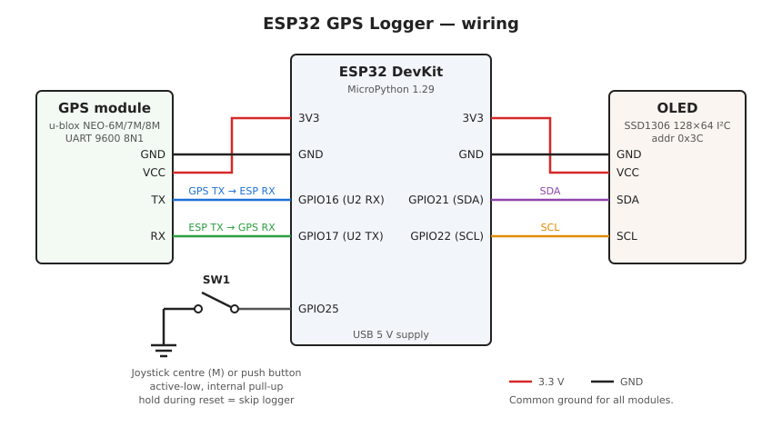

# ESP32 GPS Logger

MicroPython GPS track logger for the ESP32. It records your position to track
files on the internal flash (`.trk`, see below) both offline and while on
WiFi. When connected, it uploads finished tracks to a
[Dawarich](https://dawarich.app) server via its Overland API. On a
WiFi network (including a phone hotspot in the car) it keeps logging and
uploads already-finished files in the background.

## Features

- Reads NMEA (`RMC`, `GGA`, `GSA`, `GSV`) from a u-blox NEO-6M/7M/8M over UART, with checksum validation.
- Samples the position every second and records a point only after moving more than 3 m from the last recorded one (`MIN_MOVE`), to track files named `/gpx/YYYYMMDD_HHMMSS.trk`. A point is ~46 bytes (the old GPX XML was ~112), so a full flash holds about 2.4× more track; the pull script turns them back into GPX. Samples with a fresh HDOP worse than 5 are skipped; 2D fixes omit altitude.
- Power-loss safe: each file is always complete (header, points, footer), written in batches every 60 s (LittleFS commits on close). A line cut off by a power loss is skipped.
- Short fix losses start a new track segment; a gap over 5 minutes starts a new file. On any WiFi network, a file that has been open for 5 minutes is closed so it can upload while logging continues (offline driving stays one file; parking does not open empty files).
- On the preferred home WiFi, track recording pauses after 2 minutes below 5 km/h to avoid logging while parked. GPS speed spikes do not reset the stop timer. While paused, recording resumes in a new track only after speed stays above 5 km/h for 30 seconds and the GPS position moves at least 60 m; the samples seen during that check are kept (up to 90), so the new track starts where the car started moving. Driving out of home WiFi range during the check resumes the same way. Before a pause nothing is gated: driving near home (arrival, a slow-down at the corner) is recorded at once, and 10 seconds above 5 km/h with at least 15 m of movement restart the stop timer, so a stop right after a short drive does not pause on the time parked before it. Once moving is confirmed, recording continues normally until the stop timer expires again. This requires a valid GPS fix and speed reading.
- Keeps 32 kB of flash free; stops logging when full. Logging resumes if space is freed (checked every few seconds).
- Up to three WiFi networks. Network **#1 is home** by default and is preferred for connections and faster upload pacing; **#2 and #3** are additional networks (for example a phone hotspot). Logging and uploading work on all configured networks. Override home-network preference with `HOME1=0` / `HOME2=1` / `SSID2_HOME=1`. After a scan, a home AP at ≥ −75 dBm is tried first, then other visible known APs strongest-RSSI first (one SSID, strongest BSSID). Remaining configured networks are then tried in config order, so an SSID missed by the scan does not prevent fallback. A **hidden home** is tried first when the scan shows a strong empty-SSID AP (≥ −75 dBm) — that is how a hidden AP appears. If the scan itself fails, config order is used, under backoff. Connect is polled from the main loop so GPS sampling is not blocked. On a non-home net, when nearly stopped, the logger scans for home every ~5 min (backoff to 60 min only after a **visible** home switch fails; a failed hidden-home attempt stays at 5 min). A stop after driving resets that interval only if a visible home is in view, not an unverified empty-SSID AP. A visible home at ≥ −75 dBm, or a hidden home plus a strong empty-SSID AP, is tried between upload batches; hidden roam uses `bssid=None` (firmware matches by SSID) and never pins to the strongest blank AP. **Limitation:** with a hidden home SSID, switching home can be slower (no BSSID pin; arrival after driving does not try an unverified blank AP) and a neighbouring hidden AP can trigger a false attempt. Falls back to another configured network if that connect fails.
- Uploads finished files oldest-first, 50 points per POST. Progress is a `<file>.pos` sidecar. Offset advances only after HTTP 2xx or a durable write to `<file>.bad`. Older `.gpx` files from earlier firmware are still uploaded. If `.bad` is full (64 kB), that file's uploads pause (`BAD FULL` on the OLED) instead of dropping points. Three consecutive 400/422 responses without a success are treated as a server/config problem: backoff, no more quarantine. A `.bad` retry that still 4xxs is left on flash.
- 128×64 OLED: connected SSID (never the password), GPS fix, mode (`LOG` / `LOG+UP` / `BAD FULL`), free flash and points left. `LOG+UP` means WiFi is connected; the logger still records tracks while uploading finished ones. Missing or dropping display → headless.
- Hardware watchdog (120 s) fed in the main loop and inside long reads/POST. Uncaught exceptions print, flush, wait ~1 s and reset. Ctrl-C starts a keepalive Timer (deinit on the next `run()`, stops feeding after 10 minutes so an accidental Ctrl-C in the field is not forever-REPL). Repeated boot/import failures delay, then drop to the REPL. GPIO25 at reset skips the logger entirely.

## Hardware

| Part | Notes |
|------|-------|
| ESP32 dev board | Original ESP32 (Xtensa, `-march=xtensawin`). Use a **WROOM** module, not WROVER: on WROVER boards GPIO16/17 are wired to PSRAM and cannot be used for UART2. Flash firmware with **LittleFS** (the default ESP32_GENERIC image). Offset sidecars are not crash-atomic on FAT. |
| GPS module | u-blox NEO-6M / 7M / 8M, UART at 9600 baud |
| OLED display | SSD1306, 128×64, I²C (address 0x3C); optional (headless if absent) |
| Push button | E.g. the centre (M) press of a 5-way joystick module; optional |

### Wiring



| ESP32 pin | Connects to | Function |
|-----------|-------------|----------|
| 3V3 | GPS VCC, OLED VCC | Power |
| GND | GPS GND, OLED GND, button | Common ground |
| GPIO16 | GPS TX | UART2 RX (NMEA in) |
| GPIO17 | GPS RX | UART2 TX |
| GPIO21 | OLED SDA | I²C0 data |
| GPIO22 | OLED SCL | I²C0 clock |
| GPIO25 | Button → GND | Boot bypass (internal pull-up, active low) |

Most GPS and OLED breakout boards already have I²C pull-ups and a regulator;
check yours if powering the GPS from 5 V instead.

**ESP32-C6** (MicroPython `ESP32_GENERIC_C6` 1.29, RISC-V): the firmware
detects the board and uses UART1 instead, because the C6 has no UART2 and
GPIO16/17 are its console UART. `deploy.sh` also detects it and compiles for
`rv32imc`. The C6 has far more free internal RAM than the original ESP32 (about
190 kB largest free IDF block with the logger loaded, versus 17 kB), so
`https://` uploads work there.

| ESP32-C6 pin | Connects to | Function |
|--------------|-------------|----------|
| GPIO5 | GPS TX | UART1 RX (NMEA in) |
| GPIO4 | GPS RX | UART1 TX |
| GPIO6 / GPIO7 | OLED SDA / SCL | I²C0 |
| GPIO10 | Button → GND | Boot bypass (the C6 has no GPIO25) |

Power (3V3, GND) is wired as in the table above. The C6 board used here shows
up as `/dev/ttyACM0`: `PORT=/dev/ttyACM0 ./deploy.sh`.

**ESP32-WROVER:** GPIO16 and GPIO17 are used by the PSRAM. This firmware's
UART2 default will not work on those modules; pick a WROOM board or change
`tx`/`rx` in `gps_logger.py` to free pins.

## Software setup

Requirements on the host: Linux, Python 3, and the ESP32 flashed with
**MicroPython 1.29** (the `.mpy` version must match).

```bash
python3 -m venv .venv
.venv/bin/pip install mpremote "mpy-cross==1.29.*"

# drivers on the device (skip any already frozen into your firmware)
.venv/bin/mpremote mip install ssd1306
.venv/bin/mpremote mip install requests
```

Create `.env` and copy it to the device root:

```ini
# Network #1 is HOME by default and is preferred for connections.
# Logging and uploading happen on all configured WiFi networks.
SSID=MyHomeWifi
WPA2=wifi-password

# Phone hotspot for a car trip: NOT home, so the trip is still logged
# and finished files upload when the hotspot has data.
SSID2=PhoneHotspot
WPA2_2=hotspot-password
# HOME2=0          # default for #2/#3; set HOME2=1 to treat as home
# SSID2_HIDDEN=1   # try even when the scan does not list it

# Optional third network
SSID3=CabinWifi
WPA2_3=cabin-password
# HOME3=1
# SSID3_HIDDEN=1

GEO_URL=https://dawarich.example.com
API_KEY=your-dawarich-api-key

# [A-Za-z0-9._-]{1,32} — invalid values fall back to the default
DEVICE_ID=Dawarich-GPS-tracker
HOSTNAME=Dawarich-GPS-tracker
```

`HOME1` / `SSID_HOME`, `HOME2` / `SSID2_HOME`, `HOME3` / `SSID3_HOME` accept
`1`/`0` (also `true`/`false`). Network #1 defaults to home; #2 and #3 do not.

**Static IP (optional, per network).** Networks use DHCP unless they set
`IP` (#1), `IP2` (#2) or `IP3` (#3). A static IP also needs a gateway; the mask
defaults to `255.255.255.0` and DNS to the gateway:

```ini
IP=192.168.1.60
GW=192.168.1.1
# optional, defaults to 255.255.255.0
MASK=255.255.255.0
# optional, defaults to GW
DNS=192.168.1.111
# network #2/#3: IP2 / GW2 / MASK2 / DNS2, IP3 / GW3 / MASK3 / DNS3
```

Put comments on their own lines. A trailing `# ...` is ignored only on the
flag, IP and name keys (`HOME*`, `*_HIDDEN`, `IP*`/`GW*`/`MASK*`/`DNS*`,
`DEVICE_ID`, `HOSTNAME`); SSIDs, passwords, `GEO_URL` and `API_KEY` are taken
verbatim, because they may contain `#`. An invalid `MASK`/`DNS` falls back to
the default with a console message.

A network without `IP` stays on DHCP; moving from a static network to a DHCP
one hands the interface back to DHCP. An invalid or incomplete entry (for
example `IP` without `GW`) is ignored with a console message, so the board
falls back to DHCP rather than becoming unreachable.

**How a network is chosen**

1. Scan once (this is the only blocking radio step).
2. Deduplicate by SSID (strongest BSSID wins).
3. Prefer a home AP at ≥ −75 dBm, then other visible known APs strongest
   RSSI first. Each try is polled from the main loop with a ~12 s
   deadline (WDT fed; GPS keeps sampling). Wrong password / no DHCP →
   mark that SSID “recently failed” and move on. A leftover fail reason
   from the previous SSID (MicroPython 1.29 `connect()` does not always
   clear it) is **not** treated as this attempt failing until CONNECTING
   is seen or the 12 s deadline elapses. Confirm on device with a bad
   password on #1 and a good #2.
4. Then try configured nets not listed in the scan, in config order. This
   lets fallback work even when a scan misses a saved SSID; a hidden home is
   still preferred when a strong empty-SSID AP is seen.
5. If the scan itself fails, fall back to config order, still under backoff.
6. If every attempt fails, stay in LOG mode and retry later with capped
   exponential backoff (up to 10 minutes).
7. While connected to a **non-home** net and nearly stopped (fresh fix
   and speed ≥ 5 km/h is skipped; a stale speed does not block), rescan
   for home every ~5 min. Back off (10, 20, … 60 min) only after a
   **failed switch** to a *visible* home. Unseen home and a failed
   hidden-home attempt keep the 5 min interval. A stop after driving
   resets backoff only when a visible home is in view — not when the
   only match is an unverified empty-SSID AP (that can be a neighbour).
   A home AP at ≥ −75 dBm is preferred; if that switch fails, the
   hotspot is tried again. A hidden home is tried when the scan lists
   a strong empty-SSID AP (the ESP32 reports hidden APs that way),
   with `bssid=None` so the firmware matches by SSID. **Limitation:**
   a hidden home SSID can switch more slowly, and a neighbouring
   hidden AP can cause a false attempt. Offset only advances
   after HTTP 2xx, so a mid-upload drop is retried (Dawarich dedups).
   Far from home, a hidden home is not tried before a visible hotspot.

OLED / log show the connected SSID, never the password. Mode is `LOG+UP`
on any connected WiFi network and `LOG` when offline.

The API key is sent as `Authorization: Bearer <key>` (Dawarich accepts that
header as well as `?api_key=`). Prefer `https://` for `GEO_URL`: an `http://`
URL is still used (typical for a LAN self-host) but the logger prints a
warning, because the key and GPS data then go in the clear.

**TLS caveat:** the MicroPython `requests` library sets
`ssl.CERT_NONE`, so `https://` does **not** authenticate the server. A MITM
on the path can still see the Bearer key and the points. Pinning Let's
Encrypt ISRG Root X1 (or your own CA) would need a custom `ssl.SSLContext`
and a tiny HTTP client; that is not wired up here because mbedTLS already
sits close to the ~40 kB IDF-heap budget. Use a trusted LAN or a VPN if
that matters.

micropython-lib `requests` follows 301/302/303 with a GET and no body.
An `http://`→`https://` redirect therefore becomes a 404, not an upload.
Put the https origin in `GEO_URL` directly.

```bash
.venv/bin/mpremote cp .env :.env
```

Without `.env` the logger still records tracks; it just never goes online.

## Deploy

```bash
./deploy.sh                      # default port /dev/ttyUSB0
PORT=/dev/ttyUSB1 ./deploy.sh
```

The script compiles `gps_logger.py` to `gps_logger.mpy`, copies it with
`main.py`, removes any stray `gps_logger.py` on the device, and resets it.
`tests/` is not copied to the device.

The module must run precompiled: compiling on the device grows the Python
heap and leaves too little ESP-IDF heap (~40 kB contiguous) for mbedTLS, so
HTTPS uploads fail with `ENOMEM`.

## Usage

- Power on: the logger starts automatically, scans once for configured
  networks, then shows the status screen (or runs headless).
- **Skip the logger** (REPL / `mpremote`, **no watchdog**): hold GPIO25
  while resetting. Use this for copying files off the device.
- Ctrl-C from a running logger leaves the WDT armed; a timer feeds it for
  **10 minutes**, then the chip resets (so a stray 0x03 on USB-UART in the
  field does not leave the device in REPL forever). The next `run()` deinit's
  that timer. GPIO25 bypass is still the reliable way to pull a large `/gpx`.
- Repeated import/crash/WDT at boot: increasing delay (5 s, 10 s, … cap
  30 s), then the board stays in the REPL after 5 failures (RTC memory
  counter, `/boot_fail` fallback). The counter is **not** cleared on
  import — only after ~60 s of a healthy main loop, or by `deploy.sh`,
  or by a power cycle. A WDT reset counts. If the device is stuck in
  REPL after a failed flash, power-cycle it or
  `mpremote exec "from machine import RTC; RTC().memory(b'0')"` then
  reset. `./deploy.sh` clears the counter before rebooting.
- Track logs live in `/gpx/`; pull them with the GPIO25 bypass, then convert to GPX:

  ```bash
  .venv/bin/mpremote cp :/gpx/20261005_101500.trk .
  python3 tools/trk2gpx.py 20261005_101500.trk > 20261005_101500.gpx
  ```

  Progress is `/gpx/20261005_101500.trk.pos`. Payload-rejected batches are
  appended to `/gpx/20261005_101500.trk.bad`. After a successful upload the
  logger retries a `.bad` file a few times per boot. To re-queue by hand:

  ```bash
  .venv/bin/mpremote exec "import os; os.rename('/gpx/20261005_101500.trk.bad', '/gpx/20261005_101500.trk')"
  ```

  If `.bad` reaches 64 kB the OLED shows `BAD FULL` and **no more points
  are dropped** — pull or delete the `.bad` file, then reset.

## Configuration

Constants at the top of `gps_logger.py`:

| Constant | Default | Meaning |
|----------|---------|---------|
| `SAMPLE` | 1000 ms | Interval between position samples |
| `MIN_MOVE` | 3 m | Distance from the last recorded point before a new one is recorded |
| `FLUSH` | 60000 ms | Interval between flash writes |
| `NEW_FILE_GAP` | 300 s | Fix loss that starts a new file; also max age of an open file on WiFi |
| `HOME_STOP_DELAY` | 120 s | Time below `HOME_STOP_SPEED` before pausing track recording on home WiFi |
| `HOME_STOP_SPEED` | 5 km/h | Speed threshold for stopping/resuming track recording on home WiFi |
| `HOME_MOVE_CONFIRM` | 30 s | Continuous time above `HOME_STOP_SPEED` required to confirm movement |
| `HOME_MOVE_DISTANCE` | 60 m | GPS displacement required with sustained speed before paused home recording resumes |
| `HOME_MOVE_MAX_WAIT` | 120 s | Maximum age of a home movement check before its GPS origin is refreshed |
| `HOME_STILL_RESET` | 10 s | Sustained time above `HOME_STOP_SPEED` that restarts the stop timer (not paused) |
| `HOME_STILL_RESET_DISTANCE` | 15 m | Displacement required with `HOME_STILL_RESET` |
| `HOME_PENDING_MAX` | 90 | Samples kept in RAM while a paused track confirms movement |
| `ROAM_CHECK` | 5 min | Home-roam scan interval on a hotspot (and after arriving) |
| `ROAM_BACKOFF_MAX` | 60 min | Cap on roam retry after a failed home switch |
| `ROAM_MIN_RSSI` | −75 dBm | Minimum home RSSI to switch away from a hotspot (also boot preference) |
| `UPLOAD_GAP_AWAY` | 30 s | Pause between POSTs on a non-home net (UART drain) |
| `BOOT_OK_MS` | 60 s | Healthy `_loop` before the boot-fail counter is cleared |
| `MIN_FREE` | 32 kB | Flash reserve |
| `MAX_BATCH` | 180 | RAM points kept if flash writes fail |
| `MAX_HDOP` | 5 | Skip samples with a fresh GGA dilution worse than this |
| `UPLOAD_BATCH` | 50 | Points per POST |
| `CONNECT_TIMEOUT` | 12 s | Per-network wait for DHCP (polled, not a blocking sleep) |
| `BACKOFF_START` | 15 s | First retry after net/5xx/4xx |
| `BACKOFF_MAX` | 30 min | Cap on upload backoff and `Retry-After` |
| `AUTH_BACKOFF` | 30 min | Retry after HTTP 401 |
| `HTTP_TIMEOUT` | 15 s | Per-socket HTTP timeout (WDT 120 s is the wall-clock cap) |
| `WDT_TIMEOUT` | 120 s | Hardware watchdog |
| `KEEPALIVE_MAX` | 10 min | Ctrl-C timer may feed the WDT this long |
| `MAX_BAD_BYTES` | 64 kB | Cap on `<file>.bad`; uploads pause when full |
| `MAX_GLOBAL_PAYLOAD` | 3 | Consecutive 400/422 without 2xx → backoff, no quarantine |
| `DEVICE_ID` | `Dawarich-GPS-tracker` | Overland tracker id (`.env`, `[A-Za-z0-9._-]{1,32}`) |
| `HOSTNAME` | `Dawarich-GPS-tracker` | DHCP hostname (`.env`, `[A-Za-z0-9-]{1,32}`) |
